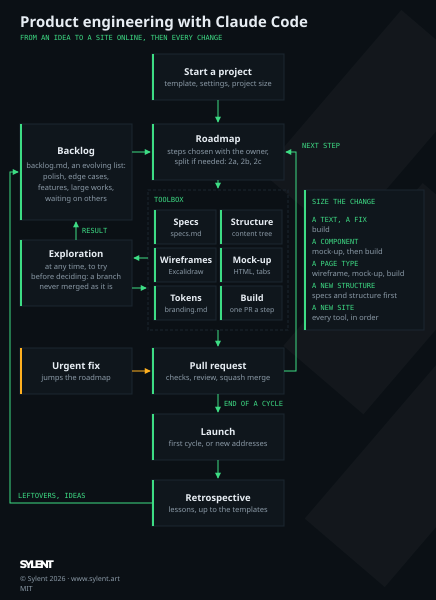

# Process

How `sylent.art` goes from an idea to a site online, then keeps growing, with Claude Code. It is the process of [astro-static-website-template](https://github.com/aunimhsn/astro-static-website-template/blob/main/process.md), made from this project, itself adapted from the process of [rust-cli-template](https://github.com/aunimhsn/rust-cli-template/blob/main/process.md), adapted to a website: the release becomes the launch on GitHub Pages.

The process is not a straight line. Its phases are **tools**, picked for each change according to what it needs: a text goes straight to the build, a new page type goes through its wireframe and mock-up first. What is not being done lives in a **backlog**; what is chosen goes to the **roadmap**, one pull request per step. Each tool ends with something the owner validates, from the cheapest to the most expensive: changing a sentence in the specifications costs less than changing a wireframe, which costs less than changing code.

This file is a living document: update it with what worked and what didn't (see [Retrospective](#retrospective)), and bring back to the template the lessons that apply to every website.

This project followed the first cycle in order (steps 0 to 14 of `roadmap.md`), then ran the classification of the offers (step 13) as a mini-cycle of its own; since the launch, each change runs the tools it needs.



## How it works

1. **Start a project** from the template, and size it with the owner: which tools this project uses, and how far (see [Size the project](#size-the-project)).
2. **The first cycle** takes the site to its launch, through every tool in order: specifications, structure, wireframes, mock-up, design system, build, launch, retrospective.
3. **Then the loop**: with the owner, pick from the [backlog](#the-backlog) what comes next, write it in `roadmap.md` as steps, size each change and split it into sub-steps when it helps ([Size a change](#size-a-change)), and run only the tools it needs. A group of steps with a goal (« testimonials and an English version ») is a **cycle**: it ends with its retrospective, and with a launch when it changes the addresses or the domain.
4. **Outside the roadmap**, two kinds of work: an [urgent fix](#urgent-fixes) that can't wait, and an [exploration](#explorations) that tries an idea before deciding.

## Size the project

At the setup, Claude Code asks how large the project is and proposes the tools and their depth; the owner decides, and the choice is written at the top of `roadmap.md`. The template is made for a full site; a smaller one skips what it doesn't need without breaking a rule.

| Project | Tools |
|---|---|
| One page (a landing page, an event) | Short specifications, one wireframe, 2 styles in the mock-up, tokens written straight into `src/styles/tokens.css`, build, launch. |
| A brand site of a few page types (the usual case, as sylent.art) | Every tool, in order, for the first cycle. |
| A site with a lot of content (a catalog, a blog) | Every tool, with the structure first and the content collections designed before the wireframes. |

## Size a change

At the start of each step, Claude Code says which tools the change needs, and why; the owner may add or remove one.

| Change | Tools |
|---|---|
| A text, a fix, a dependency | Build. |
| A visual touch, a new component | Mock-up (a tab group to compare), then build; the decision in `docs/branding.md`. |
| A new page of an existing type | Specifications, then build. |
| A new page type | Specifications, wireframe, mock-up, build. |
| A new grouping of the content, new addresses | Specifications and structure first (with the redirects), then the tools of the pages it touches. |
| A new site, a redesign | Every tool, in order. |

Only when it helps, a step is split into sub-steps, one pull request each, each one coherent and tested on its own: a step that needs several tools, or more than one review (the classification of the offers became 13a (specifications), 13b (wireframe and mock-up) and 13c (build)). A small step stays whole, since each pull request also costs a review, the checks and an archive.
When a step turns out larger than sized (a text change that questions the structure), stop and size it again with the owner rather than stretching the pull request.

## The backlog

`backlog.md` holds everything noted and not being done: an evolving list, read when the next work is chosen, not at every session (`roadmap.md` stays short).

- **What goes in**: the touches set aside during a step (polish), the edge cases that need thought, the features for later, the large works, and what waits on someone else (testimonials, the owner's course material).
- **One entry per item**: what it is in one sentence, its kind (polish, edge case, feature, large work, waiting), what it depends on, and the date it was noted. Claude Code adds an entry as soon as an idea comes up outside the current step, rather than keeping it only in its memory.
- **From the backlog to the roadmap**: when the roadmap has no step left, or at the end of a cycle, Claude Code proposes the next items with their cost and dependencies; the owner picks; the chosen items leave the backlog and become steps of `roadmap.md`.
- **Polish**: after a launch, a series of small touches from the backlog, one small pull request each, is often worth doing before anything new.
- At each retrospective, the backlog is sorted: what is done or no longer wanted leaves it.

## Urgent fixes

A fix that can't wait (a broken page online, a security alert, a wrong contact detail) jumps the roadmap:

1. Branch `fix/<short-description>` from `main`, even while a step is in progress (prepare it in a worktree if the owner is testing the step in the main folder).
2. The fix, the check that would have caught it, the code review if it changes code, a pull request opened at once.
3. Once merged, one line in `roadmap.md`, under the step in progress, and the step goes on (rebased on `main`).

## Explorations

An idea that needs trying before deciding (a 3D scene, a video for the launch, a new tool) is an exploration, not a step. It happens at any time: during a step, when a choice needs trying before it is made (on sylent.art, whether a 3D scene runs on a phone, during the mock-up); or between steps, from an idea of the backlog (the launch videos).

1. A branch `explore/<short-description>`, or a page in the scratchpad: nothing of it is merged as it is.
2. Bounded: the owner and Claude Code agree on what it must answer (« can a scene of 3D cubes run on a phone? »).
3. It ends with its result written down: during a step, the decision goes back to the step (and to `docs/`); otherwise a decision in `docs/` (kept or set aside, and why), an entry of the backlog, or a step of the roadmap that rebuilds it properly. The branch is then deleted, or kept with a line in the backlog that says why.

## The tools

| Tool | Use it when | Output | Done when |
|---|---|---|---|
| [Start a project](#start-a-project) | Once, at the start | The repository from the template, its settings, the size of the project | `main` is protected and the setup pull request is merged. |
| [Specifications](#specifications) | The site says or does something new | `specs.md`, the brand assets, the external services | The owner has answered the open questions and merged them. |
| [Structure](#structure) | The content is grouped differently, the addresses change | The content tree in Excalidraw, the URLs in `specs.md` and `src/data/urls.json` | The owner has moved the cards and chosen a lead. |
| [Wireframes](#wireframes) | A new page type, a new layout | `docs/wireframes/*.excalidraw` | The owner has edited and approved the layout. |
| [Mock-up](#mock-up) | Any visual choice | `docs/mockups/*.html` | Every page and state looks right at every width, on the owner's phone too. |
| [Design system](#design-system) | At the end of a mock-up, a new token | Tokens and decisions in `docs/branding.md` | Colors, sizes and typography are written as tokens. |
| [Build](#build) | Always | One pull request per step | The step's box of `roadmap.md` is checked. |
| [Launch](#launch) | The first cycle, a new domain or new addresses | Site on `github.io`, then on its domain | The owner has checked the site and switched the DNS. |
| [Retrospective](#retrospective) | The end of a cycle, or a phase that went badly | Changes to this file, the templates and the backlog | The lessons are written down. |

## Start a project

1. Create the repository from the template (see the README, **Start a new project**).
2. Apply the pull request settings: squash merging only, branches deleted once merged.
3. Protect `main` with a ruleset. On a free GitHub account, rulesets only apply to **public** repositories.
4. Size the project with the owner ([Size the project](#size-the-project)), and write the tools kept at the top of `roadmap.md`, with the steps of the first cycle.
5. Setup pull request: the **Project** section of `CLAUDE.md`, the name of the site in `package.json`, `astro.config.mjs` and `src/i18n/fr.json`, a port of its own for the mock-up server in `docs/technical-choices.md` (Commands), the size of the project in `roadmap.md`.
6. Open Claude Code in the project folder. Its memory is stored per project: a new session doesn't remember a conversation held in another project. To carry context over, paste a summary of it.
7. Check the connectors: `.claude/settings.json` turns off the claude.ai connectors (`disableClaudeAiConnectors`), whose instructions and tools would be sent with every message. If the project needs one, remove the setting; `/mcp` lists the servers that are on, and `/context` what fills the context. In the same file, `skillOverrides` hides from the model the skills the project doesn't use (still available with `/<name>`): adjust the list, or use `/skills`. The skills of the project are in `.claude/skills/`, copied from the template.

## Specifications

Goal: agree on **what** the site says and does before deciding **how**. For a change after the first cycle, only the sections it touches.

1. Describe the idea in a few sentences, then let Claude Code ask its questions, in batches of a few at a time. The usual ones for a brand site:
   - Who are the visitors, who decides, and what must they find before getting in touch?
   - What is the promise, what are the differentiators, what proves them?
   - Which offers or contents, grouped how, with which details?
   - What is the main action of the visitor, and what happens after it?
   - Is there a former site, whose URLs must keep working?
2. **Ask for the brand assets**, and record in `docs/branding.md` (Brand assets) what is given and what is missing: the logo (symbol and wordmark) on a dark and on a light background, in SVG if possible; a square icon for the favicon; the colors and fonts of an existing charter, with the license of each font; the photos and their rights; the logos of the partners or clients and the permission to show them; the public contact details and the legal information. The favicon and the preview card of the links are made from them (`npm run brand:images`).
3. **Check the external services early** (GitHub Pages, and a form service or analytics if the site needs one): documentation, limits, terms of use, personal data, licenses of the images and fonts. Record the limits and every risk the owner accepts, with its date, in `docs/external-services.md`.
4. Write `specs.md`: behavior and content only (what the visitor sees, what each action does, the URLs and redirects, edge cases).
5. Confirm or adapt the technical choices of `docs/technical-choices.md`, with their reasons (and the alternatives rejected), then write the steps in `roadmap.md`, each small enough for one pull request. Choose only what the specifications need: the JavaScript libraries and the weight of script a page may carry wait for the mock-up (on sylent.art, « no JavaScript » was written before the mock-up and replaced after it by GSAP and Three.js).
6. Open the pull request; the owner reads the files on GitHub (**Files changed**) or in VS Code.

## Structure

Goal: agree on how the content is grouped, and so on the addresses, before drawing the pages. On sylent.art, the classification of the offers came after the build: the URLs changed twice and the offer pages were rebuilt.

1. Claude Code draws the content tree in Excalidraw (`excalidraw-wireframes` skill): what the site offers, grouped how, with the current state and **two leads** side by side, a parking area for the items not placed yet and the open questions, one group per item so that the owner moves the cards by hand.
2. The owner moves the cards, compares the leads, and chooses; Claude Code redraws the chosen lead, completed.
3. The URLs follow from the tree: write them in `specs.md` (URLs and redirects), and the former ones, with their redirects, in `src/data/urls.json`.
4. The same tool serves any question of structure: the navigation, the sitemap, a grouping of offers.

## Wireframes

Goal: agree on the **layout** of each page type, without colors or code, in a format the owner can edit.

The `excalidraw-wireframes` skill carries out this phase: its Python helpers write the file and preview it.

1. Claude Code generates an Excalidraw file in `docs/wireframes/`: grayscale, real content from the specifications, one frame per page and width, **one group per block** so that a block moves in one click (double-click a block to edit one of its elements, **Ctrl+Shift+G** to ungroup it).
2. It checks the result with a preview, kept in its scratchpad, before handing over the `.excalidraw` file.
3. The owner edits it in VS Code with the **Excalidraw** extension (`pomdtr.excalidraw-editor`), or on excalidraw.com (**Open**, then **Save to…**).
4. Iterate: the owner draws their version, Claude Code rearranges it and fills the gaps, the owner draws the next version, and so on. Claude Code commits the owner's version before changing it, so that every iteration stays in the history.
5. Once the main frames are agreed, Claude Code draws the rest under them: other kinds of content, the states of a form, the open navigation menu at phone width, the not-found page.
6. Claude Code writes the agreed layout in `specs.md`.

Start with the phone width (mobile first): it forces to choose the essential, and the wider layouts then only rearrange the same blocks.

Working with the file:

- The VS Code extension does **not** save by itself, unlike excalidraw.com: press **Ctrl+S** before asking Claude Code to read the file.
- The extension keeps the drawing in memory and doesn't reload the file when it changes on disk. Before Claude Code rewrites the file, save and close its tab; afterwards, reopen it, and never save the old tab over the new file.

## Mock-up

Goal: choose the style with real content, every page and every state, before building the site.

The `html-mockups` skill carries out this phase, from a starting page with the style and decision tabs, a server without cache and a headless screenshot script.

1. HTML pages in `docs/mockups/`, built from the approved wireframes, with the real content. Once the site has several page types, one page per page type, with the shared styles and scripts in `docs/mockups/shared/`, shown in a viewer (phone and desktop frames side by side).
2. **Several styles, 3 or 4**, each with its own fonts, colors and density, switched with **tabs at the top of the page**, from sober to spectacular. The address keeps the chosen style (e.g. `?theme=slate`) to share it. Each style only sets tokens (CSS variables); the components use them all, so that a style is cheap to add or tweak.
   - **Start from a scale of tokens** (spacing in steps of 4 px, one size per typographic role, a few breakpoints), even rough: raw values multiply during the iterations, and rounding them at the end shifts lines of text.
   - The styles explore **new directions** for this site and its visitors. [design-journal.md](design-journal.md) records the past experiences: it may inspire one of the styles, never all of them, and nothing in it is a default.
3. The owner picks a style, or mixes two; iterate on it alone, one change at a time (e.g. the main color, then the logo, then the font).
   - **Each open decision gets its own group of tabs** on the page, so that the owner compares on screen; once decided, the tab is removed, the choice is kept, and the decision is written in `docs/branding.md`.
   - **Pixel alignments are tuned by eye on the owner's real screen**, with a tab of offsets: the display scale differs from the headless screenshots, which only give the direction.
   - **Check the mock-up on the owner's phone** before approving it: on sylent.art, most of the feedback on the built site came from the phone (a page wider than the screen on Android, titles on two lines).
   - From then on, **the mock-up is the reference** of the interface; the wireframe only fixed the first layout, and is removed with the pull request of the mock-up (the Git history keeps it).
4. Use web fonts whose license allows self-hosting (e.g. SIL Open Font License). Preload the font files, so that the page, and its screenshots, only finish loading once the fonts are there.
5. Serve the repository root without cache, on the port of the project (written in `docs/technical-choices.md`, Commands), so that the page reaches the images of the repository, even in a sandboxed browser (Flatpak, Snap), and a reload never mixes old and new files:

   ```sh
   python3 docs/mockups/serve.py 8781
   ```

   then open `http://127.0.0.1:8781/docs/mockups/<file>.html`, and reload after each change.
6. Claude Code checks its own changes with headless screenshots before asking for a review, and exports one large PNG per style to `outputs/` to compare them at a glance. A test that needs extra code runs on a copy of the page, never on the file the owner has open.

## Design system

Goal: write down the visual choices once, so that every page stays consistent.

Write them in `docs/branding.md`, as named tokens, next to the decisions they come from:

- **Colors**: background, surfaces, borders, text, weak text, accent, link, focus, error, success; contrast checked against WCAG AA.
- **Sizes**: a spacing scale (e.g. 4, 8, 12, 16, 24 px), corner radius, content width, breakpoints.
- **Typography**: fonts, sizes per role (headline, title, body, caption), weights, line heights.
- **Images**: where they come from, their license, their format and sizes (WebP at the size shown).
- **Tone of the texts**: « vous » or « tu » for the visitors, length, how the calls to action and the errors are worded.

The mock-up is then updated to use exactly these tokens, compared with screenshots taken before the rewrite to see which shifts matter; its `:root` becomes `src/styles/tokens.css`. At the end of the phase, add an entry to [design-journal.md](design-journal.md), here and in the template: the choices kept, the ones rejected, and why.

## Build

The template already holds the skeleton: layouts, tokens, not-found and redirect pages, sitemap, Open Graph, favicon, checks, CI and deployment. The first build step adapts it to the mock-up (tokens, fonts, header and footer) and turns on the deployment.

For each step of `roadmap.md`, in order:

1. Branch `<type>/<short-description>` from `main`. If the owner isn't testing anything, work in the main folder so that they can follow the changes in VS Code; otherwise, in a Git worktree outside the project.
2. Code; then run `npm run check`: formatter, linters, production build without errors or warnings, links and former URLs, width of every page on a phone.
3. Run the `code-reviewer` subagent: its notes, in French, go to `outputs/`. Claude Code summarizes them; the owner chooses which to apply.
4. Commit (Conventional Commits), push, open the pull request; it checks the step's box in `roadmap.md`.
5. The CI passes; the owner reviews and squash merges; `git pull` on `main`. The merge deploys the site to GitHub Pages.
6. When a step changes the behavior or the content plan, update `specs.md` and `roadmap.md` in the same pull request.

The owner looks at the preview on their phone after each page step, rather than all the pages at the end. When a bug reaches the owner that a check could have caught, the fix adds the check.

## Launch

1. The owner checks every page on the `github.io` address, at phone and desktop width.
2. The site is ready to share: not-found page, redirect pages, sitemap, `robots.txt`, favicon, Open Graph tags and the preview card, checked with the LinkedIn Post Inspector and the Facebook Sharing Debugger.
3. The owner verifies the domain in their GitHub account (**Settings → Pages → Verified domains**, a TXT record). The custom domain field of the repository stays empty until the switch: filled earlier, it redirects the `github.io` preview to the old site.
4. Claude Code checks that every former URL resolves and describes the DNS records to set (GitHub Pages `A` and `AAAA` on the apex, `www` as a CNAME to `<owner>.github.io.`); the owner lowers their TTL a day before, then changes the DNS (never Claude Code).
5. Once the domain points to GitHub Pages: set the custom domain in the Pages settings, enforce HTTPS, delete the `SITE_URL` and `BASE_PATH` repository variables and run the deployment again, then check that `www` and `github.io` redirect to the domain.
6. Submit the sitemap to the search engines (Google Search Console, Bing Webmaster Tools) if the owner wants to.

## Retrospective

At the end of each cycle (the first one ends with the launch), or after any tool that went badly:

1. What took longer than expected? What had to be redone? What did the owner like most?
2. Sort the backlog: the leftovers and the ideas of the cycle go in, what is done or no longer wanted goes out.
3. Read Claude Code's memory of the project: a rule or a preference that holds for the whole project moves to `CLAUDE.md` or this file, where the next sessions and the templates find it.
4. Update this file, and the template (`CLAUDE.md`, `process.md`, the skills, the skeleton) when the lesson applies to every website.

## Lessons learned

The lessons of the previous projects:

| Project | Lesson |
|---|---|
| rust-exile-market | Coded mock-ups were never exactly what the owner wanted: start with editable wireframes. |
| rust-exile-market | Read the terms of use of every data source during the specifications: a forbidden API changes the scope of version 1. |
| rust-exile-market | A Flatpak browser only receives the opened file: serve the repository with a local server. |
| rust-exile-market | On a free GitHub account, rulesets only protect public repositories. |
| rust-exile-market | The owner draws, Claude Code rearranges and completes: the wireframe iterations made the interface personal. |
| rust-exile-market | The VS Code Excalidraw extension neither autosaves nor reloads a file changed on disk: save, close, reopen. |
| rust-exile-market | Mock-ups got much better once the layout was settled: one question per phase (layout, then style). |
| rust-exile-market | Three styles on one page with tabs made the choice easy. |
| rust-exile-market | One tab group per open decision, removed once decided, turned about a hundred small decisions into quick on-screen comparisons. |
| rust-exile-market | Pixel offsets measured on headless screenshots were wrong on the owner's scaled screen: tune them by eye with a tab of values. |
| sylent.art | Mock-up as the reference: the build of a page mostly copied it, and the tokens of the mock-up became `tokens.css` as is. |
| sylent.art | The content tree came after the build: the URLs changed twice and the offer pages were rebuilt. Draw it in Excalidraw during the specifications. |
| sylent.art | Excalidraw also serves to sort content (a tree of offers, cards moved by hand), not only to lay out pages. |
| sylent.art | Bold variants (Three.js line-art scenes) showed the owner what they wanted: they couldn't have said « sober or spectacular » before seeing them. |
| sylent.art | Most feedback on the preview came from the phone: check the mock-up on a real phone, and the width of every page in CI from the first step. |
| sylent.art | A choice written before the mock-up (« no JavaScript ») was replaced once the mock-up was approved: choose the scripts after it. |
| sylent.art | The checks born from a bug (former URLs, page wider than the phone, title on two lines) kept it from coming back. |
| sylent.art | A worktree outside the folder open in VS Code is invisible to the owner: work on the branch in the main folder while they test nothing there. |
| sylent.art | Open a pull request only once the owner has seen the result (the review applied, the schema looked at). |
| sylent.art | Two mock-up servers of two projects on the same port broke the owner's page: one port per project, a server without cache. |
| sylent.art | The classification of the offers ran as a mini-cycle of its own (specifications, then wireframe and mock-up, then build): the unit of the process is the change, not the project. |
| sylent.art | Ideas kept only in Claude Code's memory are easily lost between sessions, and some wait on other people: a `backlog.md` holds them, and the roadmap only what is chosen. |
